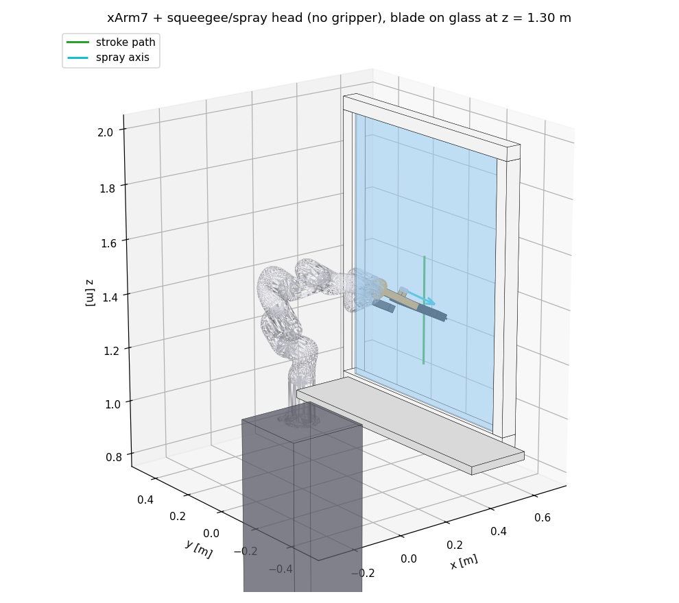

# xArm7 + головка для миття вікон (симуляційна модель, v0)

UFactory xArm7 з `bcr_description` (jinxs) **без хвата**, з головкою «скребок + форсунка + камера», прикрученою прямо до фланця. Плюс сцена з вікном для MuJoCo і демо, що притискає лезо до скла й веде вертикальну смугу.



## Склад

| Шлях | Що це |
|---|---|
| `urdf/xarm7_window_head.urdf` | URDF для ROS / MoveIt / Isaac / Gazebo. Тримач леза жорсткий |
| `mjcf/xarm7_window_head.xml` | MuJoCo, тільки робот, основа в початку координат |
| `mjcf/scene_window.xml` | MuJoCo, робот на стійці перед вікном (рама, підвіконня, скло). Тримач леза **пружний** |
| `mjcf/scene_window_rigid.xml` | Те саме з жорстким тримачем, для порівняння |
| `meshes/xarm7/visual/` | STL ланок xArm7 (вендорські) |
| `scripts/generate.py` | Параметричний генератор усіх моделей. **Розміри головки змінюються тут** |
| `scripts/demo_wipe.py` | Демо: ІК → підхід → притиск 20 Н → смуга 40 см → відрив. Друкує метрики |
| `scripts/render_preview.py` | Превʼю `preview.png` без OpenGL |
| `scripts/_source_arm_subtree.urdf` | Вихідний URDF руки з архіву bcr_arm_extract |

## Запуск

```bash
pip install mujoco numpy matplotlib
cd scripts
python3 generate.py          # перегенерувати моделі після зміни параметрів
python3 demo_wipe.py         # метрики в консоль
python3 demo_wipe.py --view  # те саме у вікні MuJoCo (потрібен дисплей)
python3 demo_wipe.py --view --delay 2   # скільки секунд тримати стартову позу перед рухом (типово 5)
python3 demo_wipe.py --rigid # жорсткий тримач: видно підстрибування леза
python3 -m mujoco.viewer --mjcf=../mjcf/scene_window.xml   # просто подивитися модель
```

## Головка (усі розміри — заглушки під перший прототип)

Розраховано на побутовий скребок ~25 см з відрізаною ручкою. Кадр фланця: z з фланця назовні, x уздовж леза.

- Довжина фланець → край гуми: **0,25 м**; ширина гуми 0,25 м; вбудований нахил леза 0° (нахил задає рука).
- Маса головки **0,382 кг** (перехідник 0,06, стійка/затискач 0,08, корпус скребка 0,12, гума 0,02, форсунка 0,03, камера 0,072). Інерції пораховані з примітивів.
- Форсунка: збоку на стійці (y = +35 мм, z = 120 мм), вісь розпилення вздовж +z, віяло вздовж x.
- Камера: корпус розміру RealSense з протилежного боку, дивиться вздовж +z. Кути огляду пораховані з реальних інтрінсиків з `bcr_description` (колір 43,3°, глибина 63,8° по вертикалі).
- Пружний тримач (тільки MJCF): ковзний суглоб уздовж z, 4000 Н/м, демпфування 20 Н·с/м, хід ±10 мм.

Кадри для планування й керування: `blade_tcp` (центр краю гуми; x уздовж леза, z у скло), `nozzle_tip` (z = напрям розпилення), `head_camera`. У MJCF ще є `ft_sensor` на фланці (сенсори сили/моменту, як датчик F/T).

## Результати демо (смуга 1,50 → 1,10 м, 0,1 м/с, нахил 30°, ціль 20 Н, тертя 0,35)

| | Пружний тримач | Жорсткий тримач |
|---|---|---|
| Сила притиску | **20,0 ± 0,23 Н** (19,6–21,0) | 20,6 ± 12,8 Н (0–39,8) |
| Втрата контакту | **0%** | 24% часу |
| Пік навантаження суглобів | j4 31%, j6 16%, решта ≤10% | так само |

Висновок для реальної головки: **пружина в тримачі леза потрібна.** Жорстке лезо при ковзанні входить у stick-slip (як гума, що скрипить по сухому склу). Навантаження на зап'ястя з короткою головкою низьке, запас великий.

## Що спрощено / відомі обмеження

- **Вода не симулюється.** Якість миття та розводи перевіряються тільки на реальному склі. Розпилення є лише кадром `nozzle_tip`.
- **Самоколізії руки вимкнені** (геометрія робота стикається тільки зі світом), їх має перевіряти планувальник.
- **Інерція `link4`** у вендорському URDF трохи порушує A+B≥C, тому в MJCF увімкнено `balanceinertia`.
- **Ліміти моментів** узято з `bcr_core` (`ArmTorqueLimit` = 80/80/60/48/42/24/18 Н·м), а не з URDF.
- **Демпфування суглобів** з URDF (10/10/5/5/5/2/2) контролер компенсує, як це робить контролер реального робота. Сухе тертя не моделюється.
- **Стійка й вікно** — довільні: основа на висоті 1,0 м, скло 0,8 × 1,0 м на відстані 0,55 м. Параметри в `SCENE` у `generate.py`.
- **Контакт гуми** — примітив-бокс з м'яким контактом. Для реальних чисел сили треба буде підібрати жорсткість під справжній скребок.
